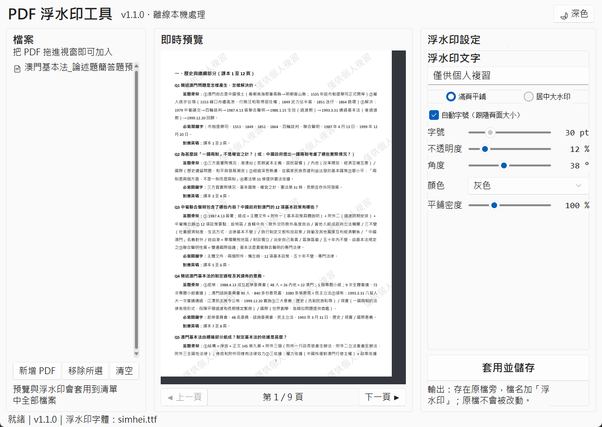
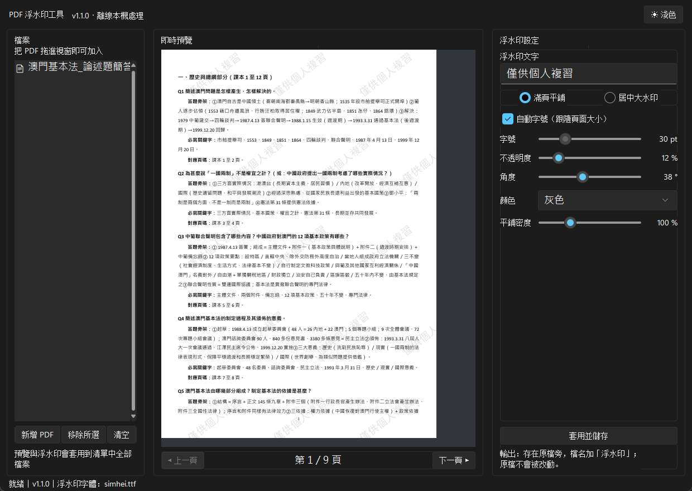

# PDF 浮水印工具（PDF Watermark Tool）

> 簡單易用、即時預覽、100% 離線的 PDF 加水印工具。
> An easy-to-use offline PDF watermark tool with live preview, built for Windows.



*右上角一鍵切換深色模式：*



## ✨ 特色

- 🖼 **即時預覽**：任何設定一改動，預覽立刻重繪，所見即所得（預覽與輸出使用同一套排版引擎）
- 🖱 **拖放操作**：把 PDF 直接拖進視窗即可加入清單，支援一次多個檔案批次套用
- 🎛 **參數全可調**：水印文字、滿頁平鋪／居中大水印、字號（可自動）、不透明度、角度、顏色、平鋪密度
- 🌙 **深色／淺色主題**：一鍵切換 Windows 11 風格現代介面（[Sun Valley ttk](https://github.com/rdbende/Sun-Valley-ttk-theme)）
- 🔒 **100% 離線**：所有處理都在本機完成，檔案絕不上傳任何伺服器
- 🛡 **原檔安全**：輸出另存新檔（檔名加「浮水印」後綴），原檔永不會被改動；加密 PDF 自動略過
- 🀄 **中文友好**：介面與水印文字皆支援中文（自動使用系統黑體／微軟正黑）

## ⬇️ 下載免安裝版（一般用戶推薦）

到 [**Releases**](../../releases) 頁面下載 `PDF-Watermark-Tool.exe`，雙擊即用，**無需安裝 Python**。

> 註：exe 未做數位簽署，首次執行時 Windows SmartScreen 可能提示「已保護您的電腦」，
> 點「更多資訊 → 仍要執行」即可（原始碼全在這個倉庫，可自行審閱或從源碼打包）。

## 📦 從源碼安裝

需要 [Python](https://www.python.org/downloads/) 3.10 或以上（Windows 安裝時勾選 *Add to PATH*）。

```bash
pip install -r requirements.txt
```

或手動安裝三個依賴：

```bash
pip install pymupdf pillow tkinterdnd2
```

## 🚀 使用

### 圖形介面（推薦）

- 雙擊 **`watermark_gui.pyw`**，或
- 雙擊 **`啟動浮水印工具.bat`**（也可以把 PDF 直接拖到 bat 圖示上）

操作：把 PDF 拖進視窗（或按「新增 PDF」）→ 右側調整設定 → 即時預覽確認 → 按「**套用並儲存**」。
輸出檔會出現在原檔旁邊，檔名加「浮水印」二字。

### 命令列

```bash
# 互動模式
python watermark_cli.py

# 帶參數：--text 水印文字  --style 1=居中大水印 2=滿頁平鋪（預設 2）
python watermark_cli.py 檔案.pdf --text "內部資料" --style 1
```

## 🪟 平台支援

本工具以 **Windows** 為主要平台（字體路徑、`os.startfile` 開啟資料夾等均為 Windows 實作）。

macOS / Linux 使用者可以自行把 `watermark_gui.pyw` / `watermark_cli.py` 裡的
`FONT_CANDIDATES` 改成系統字體路徑（例如 `/System/Library/Fonts/PingFang.ttc`），
並把 `os.startfile(...)` 換成 `subprocess.run(["open", ...])` 或 `xdg-open`。

## 📁 專案結構

```
├── watermark_gui.pyw      # GUI 主程式（雙擊即用）
├── watermark_cli.py       # 命令列版本
├── 啟動浮水印工具.bat      # Windows 一鍵啟動
├── assets/icon.ico        # 程式圖示
├── requirements.txt
└── docs/screenshot.png
```

## 🔨 自行打包 exe

```bash
pip install pyinstaller
pyinstaller --noconfirm --windowed --onefile --icon assets/icon.ico ^
    --name PDF-Watermark-Tool --collect-all tkinterdnd2 watermark_gui.pyw
```

產出在 `dist/PDF-Watermark-Tool.exe`（也可以直接用倉庫裡的 `PDF-Watermark-Tool.spec`）。

> 提示：請搭配 pymupdf 1.x 打包（`pip install "pymupdf<2"`）。
> pymupdf 2.x 會把約 49MB 的 ONNX 版面分析資源一併打進 exe，體積明顯變大。

## 🤝 貢獻

歡迎開 Issue 或 Pull Request！特別歡迎：

- macOS / Linux 完整支援
- 圖片浮水印（logo）
- 打包成免安裝 exe（PyInstaller）

## 📄 授權條款

[MIT License](LICENSE)
